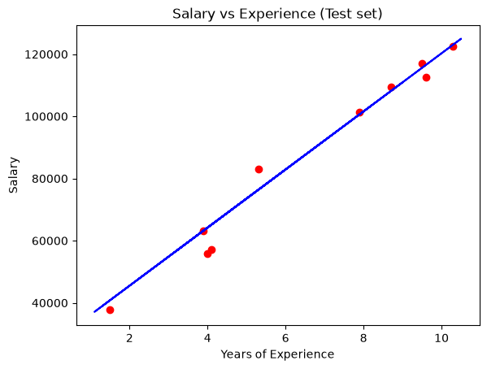
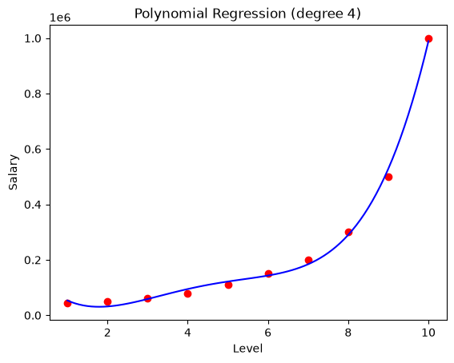
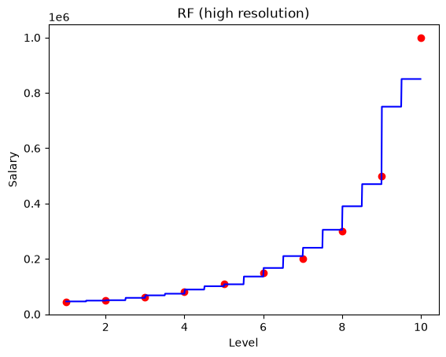
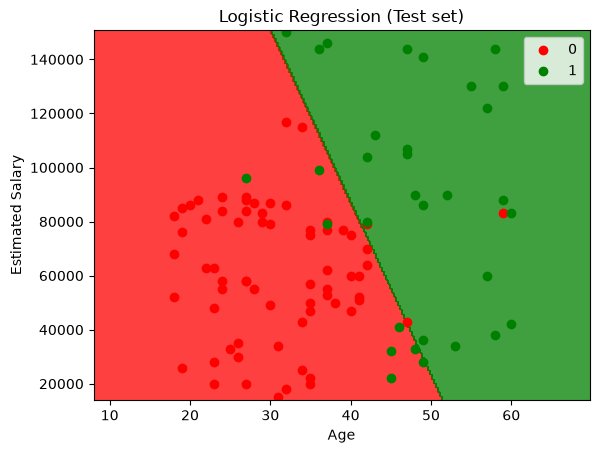

<div align="center">

# Machine Learning Course Notebooks

Solved exercises from a machine learning course: data preprocessing, five regression models and logistic regression,<br />
each one a runnable Jupyter notebook with its dataset, outputs and answers.

<br />


<sub>Course exercises · Machine Learning · 2025/2026</sub>

</div>

## Notebooks

| # | Topic | Dataset | Result |
|:---:|---|---|---|
| 01 | [Data preprocessing](01-data-preprocessing/data-preprocessing.ipynb) | Customers (10 rows) | Imputation, one-hot and label encoding, split, scaling |
| 02 | [Preprocessing KDD Cup 99](02-kdd-preprocessing/kdd-preprocessing.ipynb) | KDD Cup 99, 10% subset (494,020 connections) | 41 features become 118 after one-hot encoding, binary normal/attack label |
| 03 | [Simple linear regression](03-simple-linear-regression/simple-linear-regression.ipynb) | Salary vs years of experience | R² = 0.975 |
| 04 | [Multiple linear regression](04-multiple-linear-regression/multiple-linear-regression.ipynb) | Power plant output (9,568 readings) | R² = 0.933 |
| 05 | [Polynomial regression](05-polynomial-regression/polynomial-regression.ipynb) | Position salaries + power plant | R² = 0.944 |
| 06 | [Support vector regression](06-support-vector-regression/support-vector-regression.ipynb) | Position salaries + power plant | R² = 0.948 |
| 07 | [Decision tree regression](07-decision-tree-regression/decision-tree-regression.ipynb) | Position salaries + power plant | R² = 0.921 |
| 08 | [Random forest regression](08-random-forest-regression/random-forest-regression.ipynb) | Position salaries + power plant | R² = **0.965** |
| 09 | [Logistic regression](09-logistic-regression/logistic-regression.ipynb) | Social network ads (400 users) | 89% accuracy |

The regression notebooks (05 to 08) have two parts: **Part A** fits the model on the 10-row position salary table and plots the curve, **Part B** trains it on the power plant dataset and scores it on a held-out 20% test set.

### Regression models on the same test set

Predicting the electrical output (PE, in MW) of a combined cycle power plant from temperature, exhaust vacuum, pressure and humidity, `random_state = 0`, 1,914 test readings:

| Model | R² | RMSE |
|---|:---:|:---:|
| Random forest (100 trees) | **0.965** | **3.20 MW** |
| SVR (RBF kernel) | 0.948 | 3.90 MW |
| Polynomial (degree 4) | 0.944 | 4.04 MW |
| Multiple linear | 0.933 | 4.44 MW |
| Decision tree | 0.921 | 4.81 MW |

<table>
  <tr>
    <td width="50%"><p align="center"><b>Simple linear regression, test set</b></p></td>
    <td width="50%"><p align="center"><b>Polynomial regression, degree 4</b></p></td>
  </tr>
  <tr>
    <td><p align="center"><b>Random forest, high resolution</b></p></td>
    <td><p align="center"><b>Logistic regression, test set</b></p></td>
  </tr>
</table>

## Running the notebooks

```bash
pip install -r requirements.txt
jupyter notebook
```

Each notebook reads its data from `../data/`, so open them from their own folder. All of them run top to bottom in under a minute.

## Datasets

| File | Source |
|---|---|
| `Data_Preprocessing.csv`, `Salary_Data.csv`, `Position_Salaries.csv`, `Social_Network_Ads.csv` | Small teaching datasets provided with the course |
| `Power_Plant.csv` | *Combined Cycle Power Plant*, UCI Machine Learning Repository (Tüfekci, 2014), CC BY 4.0 |
| `KDDCup99.csv.gz` | KDD Cup 1999, 10% subset, UCI Machine Learning Repository, gzip-compressed (pandas reads it directly) |

---

<div align="center"><sub>Part of <a href="https://github.com/creepout777">Yassine Aitaouicha's projects</a></sub></div>
